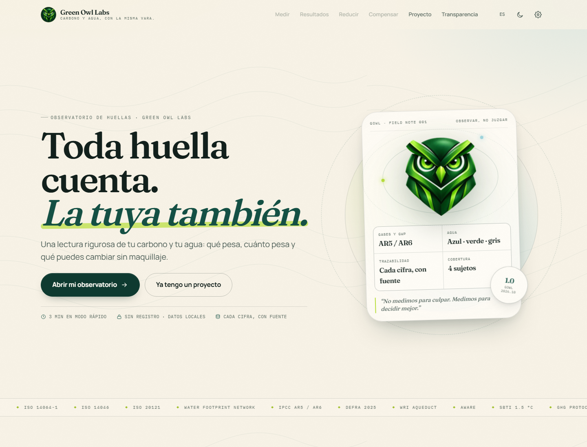
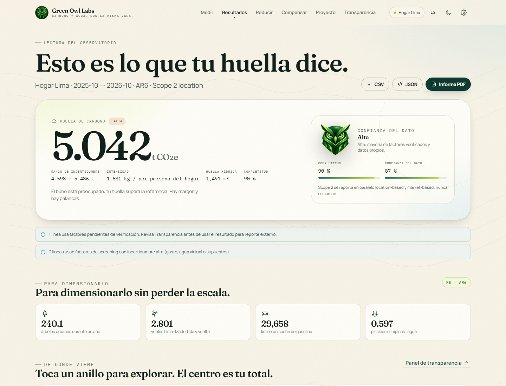
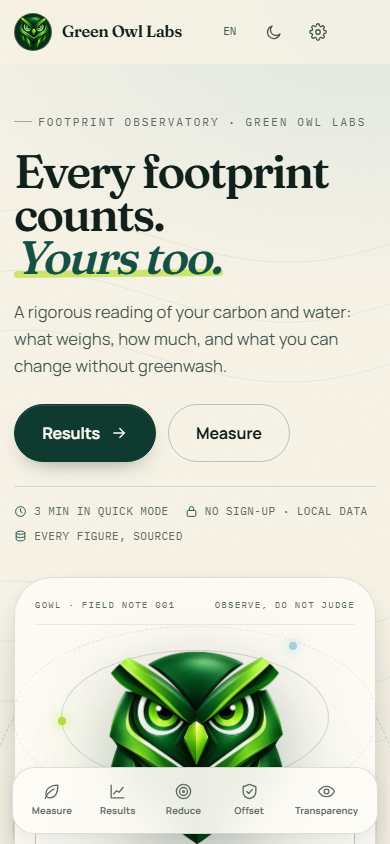
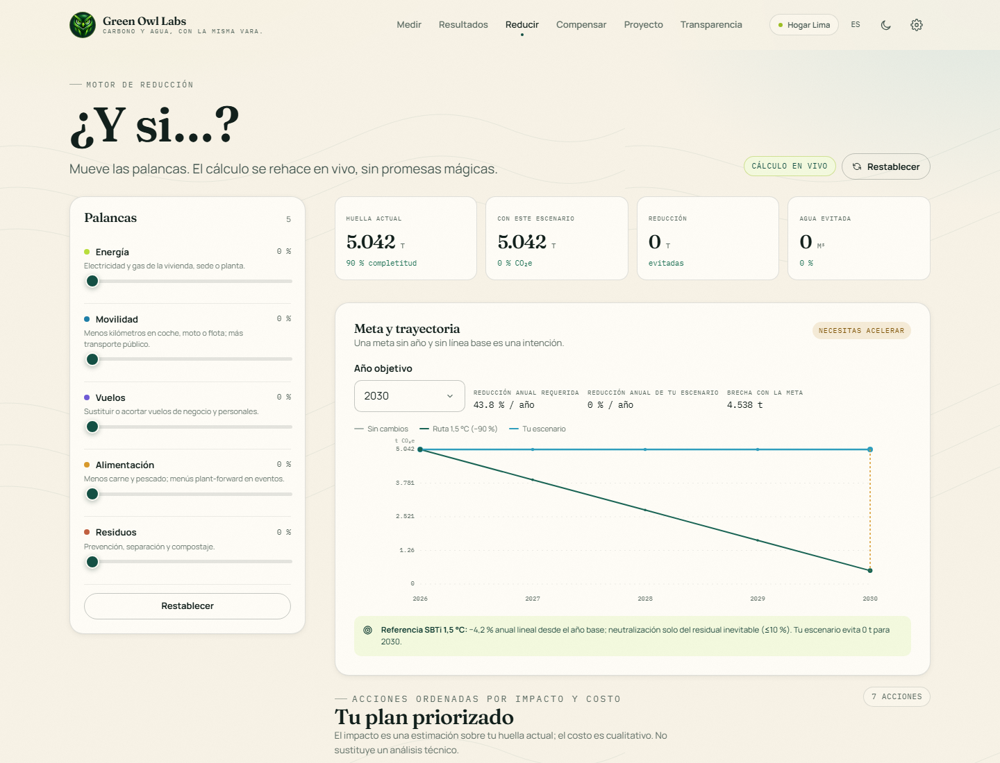
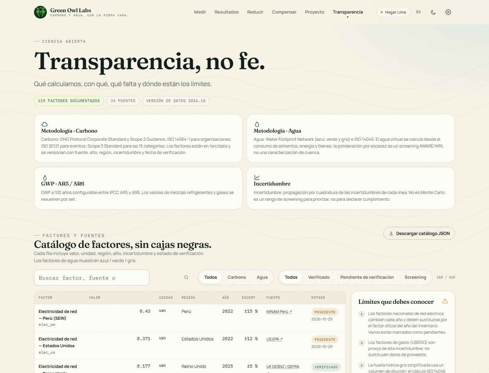

# Green Owl Labs · Calculadora de huella de carbono e hídrica

> **Carbono y agua, con la misma vara.** Una calculadora que no promete neutralidad: muestra qué pesa, cuánto pesa y qué se puede cambiar sin greenwashing.

Aplicación web local-first para medir, entender y reducir la huella de **carbono (t CO₂e)** y **agua (m³ azul, verde y gris)** de personas, empresas, eventos y productos. Construida con React 19, TypeScript, Vite, Zod y SVG propio. Sin backend, sin cuentas, sin venta de créditos.

**Demo:** <https://buhonegro5000.github.io/Calculadora-hidrica-y-carbono/>



---

## Por qué existe

La mayoría de calculadoras devuelven un número y desaparecen. Esta devuelve un **observatorio**: un proyecto con límites, periodo, método, año base, auditoría línea a línea, escenarios, plan priorizado y exportables que otra persona puede revisar.

Tres reglas de diseño:

1. **Cada cifra tiene fuente.** Los factores viven en JSON versionados, nunca en la interfaz. Cada línea conserva valor, unidad, fuente, año, región, incertidumbre, estado y fecha de verificación.
2. **Medir no es compensar.** La jerarquía es evitar → reducir → compensar. La compensación solo aplica al residual inevitable y no se presenta como neutralidad.
3. **La incertidumbre se declara.** El resultado es una estimación de screening trazable, no una verificación ISO 14064-1 ni una certificación.

---

## Lo que incluye

| Área | Implementación |
| --- | --- |
| Entidades | Persona/hogar, empresa u organización, evento y producto. |
| Niveles | Rápido, estándar y experto, con preguntas progresivas y valores típicos. |
| Carbono | GHG Protocol (Scope 1, 2 y 3), ISO 14064-1, ISO 20121 para eventos, GWP AR5/AR6 y Scope 2 dual location/market. |
| Agua | Water Footprint Network e ISO 14046: azul, verde y gris; directa e indirecta; agua virtual; ponderación opcional por escasez AWARE/WRI. |
| Resultados | Total, intervalo de incertidumbre, equivalencias, comparación nacional/sectorial, desglose por alcance y categoría, semáforo y búho reactivo. |
| Escenarios | Palancas “¿y si…?” en vivo, metas 2030/2040/2050, trayectoria SBTi 1,5 °C y brecha contra la meta. |
| Plan | Acciones ordenadas por impacto/costo, selección de plan, residual y hoja de ruta. |
| Compensación | Criterios de calidad verificables, familias de proyectos, costos indicativos y advertencia explícita de no neutralidad. |
| Exportables | CSV con BOM y `sep=;`, JSON de proyecto con resultado y metadatos, catálogo completo de factores en JSON. |
| Informe | Informe imprimible/PDF de marca con resumen, alcances, categorías, inventario, supuestos y fuentes. |
| Proyectos | Persistencia local, comparación de periodos, borrado con confirmación y exportación individual. |
| Factores | Gestor de catálogo con filtros, overrides sin destruir la base, factores nuevos con fuente/año/motivo, versiones, reversión, auditoría, roles, importación CSV/JSON con vista previa, cobertura de huecos y snapshot por cálculo. |
| Idioma y tema | Español/inglés, claro/oscuro/sistema, formato local de cifras. |
| Accesibilidad | WCAG AA, navegación por teclado, encabezados ordenados, foco visible, `prefers-reduced-motion`, contraste auditado en claro y oscuro. |
| PWA | Service worker con shell precacheado, navegación network-first con caída al índice y activos cache-first. |



---

## Inicio rápido

Requisitos: Node.js 20+ y npm.

```bash
npm install
npm run dev
```

La app queda disponible en `http://127.0.0.1:5173/`. Si ese puerto está ocupado, Vite elige el siguiente.

```bash
npm run build      # typecheck + build de producción
npm run preview    # sirve dist/ para probar la PWA
npm test           # 32 tests del motor y del registro de factores
npm run typecheck  # TypeScript sin emitir
```

### Recorrido de demostración

1. **Medir** → elige “Persona u hogar”.
2. Acepta los valores típicos y pulsa **Ver resultados**.
3. En **Resultados**, abre el desglose, revisa el panel de transparencia y exporta CSV/JSON.
4. En **Reducir**, mueve las palancas y añade acciones al plan.
5. En **Compensar**, revisa el residual y los criterios de calidad.
6. En **Informe**, usa **Imprimir / PDF**.
7. En **Factores**, revisa la cobertura, crea un factor o ajusta un factor base con **Crear override** y luego **Restaurar valor original**.
8. Crea un segundo proyecto con otro periodo y compáralo en **Proyecto**.

Documentación de factores: [`docs/FACTOR_MANAGER.md`](docs/FACTOR_MANAGER.md) y [`docs/FACTOR_GAPS.md`](docs/FACTOR_GAPS.md).

### Despliegue en GitHub Pages

El repositorio incluye el workflow [`.github/workflows/deploy-pages.yml`](.github/workflows/deploy-pages.yml), que ejecuta los tests, compila con la base correcta y publica `dist/` en GitHub Pages en cada push a `main`.

Para activarlo, una sola vez:

1. Ve a **Settings → Pages** del repositorio.
2. En **Build and deployment → Source**, elige **GitHub Actions**.
3. Haz push a `main` y espera a que termine el workflow **Deploy to GitHub Pages**.

La app queda en <https://buhonegro5000.github.io/Calculadora-hidrica-y-carbono/>. Para compilar localmente con esa misma base:

```bash
VITE_BASE=/Calculadora-hidrica-y-carbono/ npm run build
npm run preview
```

---

## Capturas

| Escritorio | Móvil |
| --- | --- |
|  |  |

| Reducción | Transparencia |
| --- | --- |
|  |  |

---

## Arquitectura

```text
src/
  app/            router hash, guards y navegación
  components/     Shell, gráficos SVG, UI, iconos, ajustes
  data/           factores, fuentes, preguntas, benchmarks, dietas, acciones
  engine/         cálculo, unidades, GWP, escenarios, auditoría
  i18n/           diccionarios ES/EN y proveedor de idioma
  lib/            exportables, descargas, formato
  screens/        Welcome, Onboarding, Wizard, Results, Reduce, Compensate,
                  Projects, Report, Transparency
  store/          estado de app, proyectos y preferencias
  styles/         tokens, base, componentes y pantallas
public/           manifest, service worker, iconos, robots
docs/             metodología, factores, roadmap, autoevaluación
```

Flujo de datos:

```text
preguntas + respuestas + factores JSON
        │
        ▼
  calculate(project)
        │
        ├── líneas auditables (cantidad × factor)
        ├── totales por alcance, categoría y agua
        ├── incertidumbre por cuadratura
        └── advertencias y completitud
        │
        ▼
  resultados · escenarios · plan · informe · exportables
```

### Decisiones de stack

- **React 19 + TypeScript + Vite**: iteración rápida, tipado fuerte y build estático.
- **Rutas diferidas con `React.lazy`**: la portada viaja en el chunk inicial; el motor, los datos y las pantallas se cargan cuando la ruta los necesita.
- **CSS propio con tokens**: control total de la identidad editorial, modo oscuro y contraste; sin dependencia de utilidades.
- **SVG propio** para donuts, sunburst, barras y trayectorias: gráficos ligeros, accesibles y coherentes con la marca.
- **Zod** en la frontera de datos: los JSON se validan al cargar y el build falla si una fuente o un factor están huérfanos.
- **Vitest** para casos de referencia del motor.
- **Sin Tailwind, sin Recharts, sin Framer Motion**: menos peso, menos capas y una identidad que no se parece a una plantilla.
- **Sin backend**: los proyectos viven en `localStorage`; nada se envía a un servidor.

### Persistencia

| Clave | Contenido |
| --- | --- |
| `gol.projects.v1` | Proyectos completos. |
| `gol.active.v1` | Proyecto activo. |
| `gol.lang.v1` | Idioma (`es`/`en`). |
| `gol.theme.v1` | Tema (`light`/`dark`/`system`). |
| `gol.splash.v1` | Evita repetir el splash en la sesión. |

---

## Método en una página

- **Carbono** = actividad × factor × multiplicador de opción. Cada línea se convierte a la unidad del factor con conversión tipada; una incompatibilidad lanza error, no se ignora.
- **Scope 2** se calcula siempre en paralelo: location-based con el factor de red y market-based con el factor contractual (o el de red si no existe, con advertencia). El headline usa el método elegido y **nunca se suman ambos**.
- **GWP**: AR5 o AR6 según el proyecto; los refrigerantes y gases usan el valor correspondiente. La aviación puede incluir forzamiento radiativo (RF).
- **Agua**: azul (superficial/subterránea), verde (lluvia incorporada) y gris (dilución de contaminantes). Se declara la parte directa e indirecta y el agua virtual de alimentos, productos y servicios.
- **Escasez**: opcional. Multiplica el agua azul por el factor AWARE del país (`blueScarce`) sin alterar el total físico.
- **Incertidumbre**: propagación por cuadratura de las incertidumbres por línea, declarada como screening. No es Monte Carlo.
- **Benchmarks**: nacionales, sectoriales o por asistente, usados solo como referencia y marcados como screening.
- **Completitud**: campos numéricos tocados / campos numéricos visibles. La confianza combina completitud y proporción de líneas verificadas.
- **Escenarios**: reducción porcentual sobre campos concretos; la dieta se modela con perfiles y reducción de carne/pescado.
- **Plan**: acciones ordenadas por `impacto / (costo + 0,5)`, con tope del 95 % de reducción acumulada.
- **Compensación**: residual tras el plan, criterios de calidad y tres familias con riesgos distintos. Nunca se vende ni se emite crédito.

Detalle completo en [docs/METHODOLOGY.md](docs/METHODOLOGY.md).

---

## Datos y trazabilidad

- **81 factores de carbono**: 54 verificados, 14 pendientes y 13 de screening.
- **38 factores de agua**: 6 verificados y 32 de screening.
- **34 fuentes** registradas con organización, título, año y URL.
- Factores en `src/data/carbonFactors.json` y `src/data/waterFactors.json`.
- Fuentes en `src/data/sources.json`; benchmarks, escasez y dietas en archivos separados.
- Validación Zod al cargar y comprobación de integridad referencial: una fuente o factor huérfano detiene la app.
- Cada línea exportada incluye `sourceId`, organización, año, estado, incertidumbre y la frase de cálculo.
- `DATA_VERSION` actual: **2026.10**.

Catálogo y criterios de actualización en [docs/FACTORS.md](docs/FACTORS.md).

---

## Exportables

| Formato | Contenido |
| --- | --- |
| **CSV** | Una fila por línea, con proyecto, entidad, país, periodo, método, alcance, categoría Scope 3, actividad, cantidad, unidad, factor, kg CO₂e location/market, agua azul/verde/gris, incertidumbre, fuente, año, estado, supuestos y cálculo. BOM UTF-8 y `sep=;` para Excel. |
| **JSON de proyecto** | `schema`, fecha, versión de datos, idioma, proyecto, resultado completo y metadatos metodológicos. |
| **Catálogo JSON** | Todos los factores, fuentes, benchmarks, escasez y conteos. |
| **PDF** | Informe imprimible con CSS de impresión; oculta navegación y toolbar. |

Los exportables son reproducibles: conservan los supuestos y la fuente de cada línea. No sustituyen una revisión de terceros.

---

## Accesibilidad, rendimiento y PWA

- **WCAG AA**: contraste verificado en claro y oscuro, foco visible, etiquetas accesibles, encabezados en orden, soporte de teclado y `prefers-reduced-motion`.
- **Auditoría**: Lighthouse en las 10 rutas, en tema claro y oscuro. Accesibilidad, buenas prácticas y SEO: **100/100** en todas las rutas auditadas. La portada, medida sobre el build final, obtiene **100 en rendimiento de escritorio** (FCP 0,38 s · LCP 0,58 s · TBT 3 ms · CLS 0,0015) y **94 en móvil**.
- **PWA**: manifest, iconos 64/180/192/512 y service worker. Probado con `npm run preview`: la app carga y renderiza con la red desactivada.
- **Peso**: la carga inicial es de ~340 kB de JS (105 kB gzip) y ~118 kB de CSS (24 kB gzip). El catálogo de factores (142 kB, 37 kB gzip) y las pantallas se cargan bajo demanda; el proveedor de factores solo se monta en rutas de cálculo, informe o gestión. El code-splitting por ruta está aplicado.
- **Móvil primero**: navegación inferior, hero reordenado, tarjetas apiladas y sin desbordamiento horizontal a 390 px.

---

## Tests y verificación

```bash
npx tsc --noEmit   # OK
npx vitest run     # 32/32
npm run build      # OK
```

Casos cubiertos por el motor:

- Cálculo de referencia de un hogar y una empresa.
- Conversión de unidades y rechazo de dimensiones incompatibles.
- Scope 2 location y market en paralelo.
- GWP AR5/AR6 y factor RF de aviación.
- Agua azul/verde/gris y ponderación por escasez.
- Propagación de incertidumbre.
- Completitud y advertencias.
- Escenarios y residual.
- Integridad del catálogo de factores.

Verificación funcional realizada en navegador: onboarding, creación y recarga de proyectos, wizard, resultados, escenarios, plan, compensación, exportables, informe, tema, idioma, comparación de periodos, borrado y recarga offline.

---

## Límites conocidos

- Es una herramienta de **screening y gestión**, no una verificación acreditada.
- Los benchmarks nacionales, sectoriales y por asistente son referencias de screening; no sustituyen un inventario primario.
- El agua gris se simplifica por volumen de dilución y se declara como screening.
- La incertidumbre es analítica por cuadratura; no modela correlaciones ni distribuciones.
- La compensación es informativa: no hay compra, emisión ni retiro de créditos.
- El PDF depende del diálogo de impresión del navegador.
- No hay backend, cuentas, sincronización ni colaboración multiusuario.
- Algunos factores están pendientes de verificación y así se muestran en la UI y en los exportables.

---

## Documentación

- [Metodología](docs/METHODOLOGY.md)
- [Factores y fuentes](docs/FACTORS.md)
- [Roadmap](docs/ROADMAP.md)
- [Autoevaluación](docs/SELFEVALUATION.md)

---

© Green Owl Labs. Los logos, el emblema y la identidad visual pertenecen a Green Owl Labs. Los factores citados pertenecen a sus fuentes originales.
